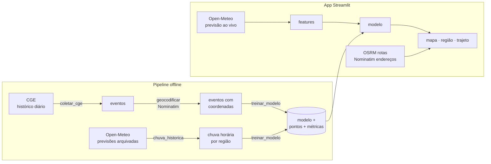

# 🌧️ Alerta Alagamento SP

Aplicação web que **prevê alagamentos em São Paulo** combinando o histórico oficial de
alagamentos do CGE (Centro de Gerenciamento de Emergências da Prefeitura) com a previsão
do tempo hora a hora. Projeto acadêmico de análise de dados.

## O que o app faz

| Página | Para quê |
|---|---|
| 🗺️ **Visão geral** | Mapa e ranking dos pontos com maior chance de alagar nas próximas 3, 6, 12 ou 24h, alertas e previsão hora a hora de cada ponto |
| 📍 **Minha região** | Para a **localização atual** (pedida ao abrir o app) ou um endereço: tempo agora, chuva e risco previstos, pontos de alagamento próximos e histórico da região |
| 🚗 **Trajeto seguro** | Compara rotas alternativas pela chance de passar por um ponto alagado e indica o **melhor horário para sair** |
| 📊 **Análise histórica** | Análise exploratória: sazonalidade, hora do dia, zonas, relação chuva × alagamento, mapa de calor, download dos dados |
| 🧠 **Como o modelo funciona** | Métricas de validação, calibração, importância das variáveis e limitações |

O **modo simulação** (barra lateral) força uma chuva em toda a cidade para demonstrar o app em dia seco.

## Arquitetura



## Metodologia

1. **Coleta:** o histórico diário publicado pelo CGE é raspado desde 2019. Cada registro tem
   rua, bairro, horário de início e fim, e se o local ficou intransitável.
2. **Geocodificação:** as abreviações são expandidas ("R" → "Rua", "AV" → "Avenida"...) e o endereço
   é buscado no OpenStreetMap. O candidato mais próximo do bairro informado é aceito (até 4 km).
   Sem correspondência, o evento fica no centro do bairro.
3. **Chuva:** a chuva horária de cada região (grade de 0,1° ≈ 11 km) vem das **previsões arquivadas**
   do Open-Meteo, a mesma fonte que o app consulta ao vivo. Assim o modelo é treinado com dados
   da mesma natureza que recebe em produção.
4. **Modelo:** unidade = região × hora. Alvo = o CGE registrou início de alagamento.
   Variáveis = chuva acumulada (1h, 3h, 6h, 24h, 72h), hora do dia e taxa histórica de alagamentos da região.
   Comparação entre regressão logística, gradient boosting e a heurística do protótipo, com
   **validação temporal** (treino no passado, teste no futuro).
5. **Do modelo ao ponto:** p(ponto) = p(região) × participação histórica do ponto nos alagamentos da região.

## Resultados

**Dados:** 6.013 alagamentos registrados pelo CGE entre jan/2019 e out/2026, em 648 dias, e
1,17 milhão de horas-região de chuva. Validação temporal: treino até jun/2025, teste de jul/2025 a out/2026.

| Modelo | ROC-AUC | PR-AUC | Brier |
|---|---|---|---|
| Heurística do protótipo (limiares fixos) | 0,877 | 0,017 | 0,00342 |
| Gradient boosting | 0,942 | 0,046 | 0,00193 |
| **Regressão logística (escolhido)** | 0,928 | 0,046 | 0,00193 |

Alagamento é raro (0,20% das horas-região no teste), então um classificador aleatório teria PR-AUC ≈ 0,002.
O modelo escolhido é **~23× melhor que o acaso** e **2,7× melhor que a heurística**. O gradient boosting
empata no PR-AUC (+1,5%), abaixo do ganho mínimo de 5% definido para justificar um modelo mais complexo.

**Principais achados da análise:**
- 82% dos alagamentos ocorrem de novembro a março, com pico às 16h (chuvas convectivas de fim de tarde).
- Dias com mais de 20 mm na região mais chuvosa têm alagamento em mais de 70% dos casos. Abaixo de 1 mm, em 2,5%.
- **A cidade alaga cada vez menos com a mesma chuva:** eram 89 alagamentos por 100 mm em 2019 e 33 em 2026.
  O modelo trata isso com pesos temporais e recalibração da prevalência.
- As variáveis mais importantes são o histórico de alagamentos da região e a chuva acumulada em 6h e 3h.

Os gráficos de validação (calibração, importância, curva de resposta) estão na página
**"Como o modelo funciona"** do app e em [`models/metricas.json`](models/metricas.json).

## Como rodar

```powershell
python -m venv .venv
.\.venv\Scripts\activate
pip install -r requirements-dev.txt
streamlit run app.py
```
Abre em http://localhost:8501. Os artefatos do modelo já vêm no repositório, então o pipeline
só é necessário para atualizar os dados.

### Atualizar dados e re-treinar
```powershell
python -m pipeline.executar            # completo (1ª vez: 1-3 h, limitado pelas APIs públicas)
python -m pipeline.executar --pular-coleta
```
Cada etapa também roda isoladamente: `python -m pipeline.coletar_cge`, `pipeline.geocodificar`,
`pipeline.chuva_historica` e `pipeline.treinar_modelo`. Todas são incrementais e usam cache.

### Testes
```powershell
pytest
```
Testes de unidade (parser do CGE, features, grade, risco) e de fumaça de todas as páginas.

### Publicar

**GitHub Pages (recomendado, grátis):** o app roda inteiro no navegador do visitante via
[stlite](https://github.com/whitphx/stlite), Streamlit em WebAssembly, sem servidor. O arquivo
[`index.html`](index.html) carrega o app. Para ativar, vá em **Settings → Pages → Source: Deploy from a branch →
Branch: `main` / `(root)`**. O link fica `https://<usuário>.github.io/alagamento-sp/`. A primeira abertura
leva ~20 s, porque o navegador baixa o Python; nas próximas o Python já está em cache.

Para testar localmente: `python -m http.server 8600` e abrir http://localhost:8600.

> Ao criar arquivos novos que o app usa (páginas, módulos, dados), adicione-os à lista `arquivos` do `index.html`.

**App Android (APK):** baixe [`apk/AlertaAlagamentoSP.apk`](apk/AlertaAlagamentoSP.apk) no celular e
instale (o Android pede para permitir "instalar apps desconhecidos"). Ao abrir, o app **pede a
localização** e já mostra o risco de alagamento na área da pessoa. Se ela recusar, o app abre
normalmente e dá para buscar um endereço.

Como funciona: [`android/`](android/) é um app nativo mínimo (Java, sem bibliotecas) com um WebView
que roda o mesmo `index.html` + código Python empacotados dentro do APK, servidos na origem segura
`https://appassets.androidplatform.net/`. O `index.html` pede a localização (`navigator.geolocation`,
que no app aciona a permissão do Android) e abre a página "Minha região" com `?lat=..&lon=..`.
Precisa de internet (previsão do tempo, mapas e, na 1ª abertura, o Python).

Para gerar o APK de novo (requer JDK 17 e Android SDK; `ANDROID_HOME` apontando para o SDK):
```powershell
cd android
.\gradlew.bat assembleRelease     # -> app\build\outputs\apk\release\app-release.apk
eleasepp-release.apk
```
O GitHub Actions também gera o APK a cada push (workflow **apk**, aba Actions → Artifacts).
A chave de assinatura (`android/app/assinatura.jks` + `assinatura.properties`) fica **só na máquina
de quem publica**, fora do git. Sem ela o APK é assinado com a chave de debug; nesse caso, para
instalar por cima de uma versão assinada com outra chave, desinstale a anterior antes.

**Outras opções:** Streamlit Community Cloud (aponte para `app.py`) ou Docker
(`docker build -t alagamento-sp .` e depois `docker run -p 8501:8501 alagamento-sp`).

## Estrutura

```
app.py                  entrada do app (navegação, barra lateral)
paginas/                uma página por arquivo
src/
  config.py             parâmetros (grade, níveis de risco, fuso)
  servico.py            camada de dados do app: cache, APIs, inferência
  features.py           engenharia de features (compartilhada treino/app)
  risk.py               níveis de risco e agregações de probabilidade
  weather.py · geo.py   clientes Open-Meteo, Nominatim e OSRM
  grade.py · ui.py      grade espacial e componentes visuais
pipeline/               coleta → geocodificação → chuva → treino
models/                 modelo (coeficientes em JSON) e métricas
index.html              página do GitHub Pages (app no navegador via stlite)
android/                app Android (WebView que empacota o index.html e o app)
apk/                    APK pronto para instalar
data/processed/         eventos geocodificados, pontos, regiões, série diária
tests/
```

## Limitações

- A previsão do tempo erra, principalmente nas pancadas de verão, que são muito localizadas. A
  resolução dos modelos meteorológicos (~10–25 km) não enxerga a chuva rua a rua.
- O CGE registra alagamentos em vias monitoradas. Ruas pequenas e bairros periféricos podem estar sub-representados.
- Parte dos eventos tem precisão de bairro, não de rua.
- Combinar horas e pontos assumindo independência é uma simplificação.
- **Não substitui os alertas oficiais** da Defesa Civil (SMS 40199) e do CGE.

## Fontes de dados

- [CGE — Centro de Gerenciamento de Emergências Climáticas (Prefeitura de SP)](https://www.cgesp.org): histórico de alagamentos
- [Open-Meteo](https://open-meteo.com): previsão do tempo e previsões arquivadas (CC BY 4.0)
- [OpenStreetMap / Nominatim](https://nominatim.org): geocodificação (ODbL)
- [OSRM](https://project-osrm.org): rotas
